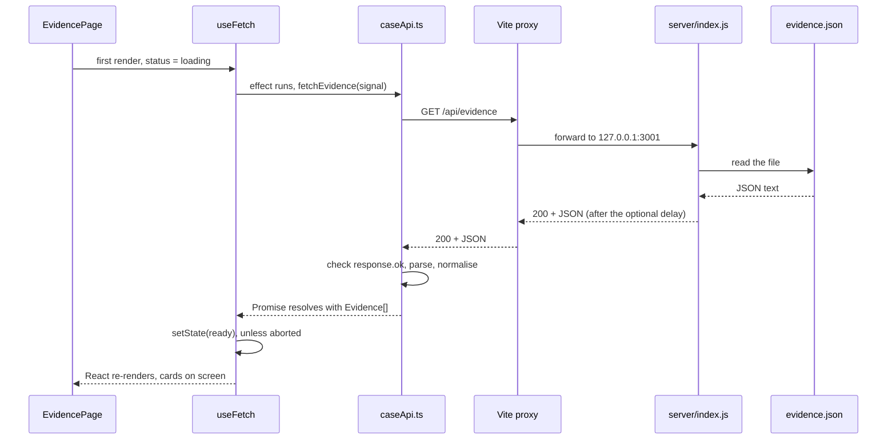

# Data flow: one piece of data from file to screen (Exercise 6)

This follows **one piece of data, the evidence list**, from the JSON file on disk to the cards on screen. 
The other four datasets (case, people, locations, timeline) take exactly the same path.

## The flow

The data moves from top to bottom. The numbers match the table further down.

```text
────────────────────── BACKEND (development only) ──────────────────────
    ┌──────────────────────────────────────────────────────────────────┐
    │ 1  public/data/evidence.json                                     │
    │    the data, stored as a file                                    │
    └──────────────────────────────────────────────────────────────────┘
                                      │
                                      │  file read
                                      ▼
    ┌──────────────────────────────────────────────────────────────────┐
    │ 2  server/index.js  ·  GET /api/evidence                         │
    │    reads the file and sends it as JSON                           │
    │    can add a delay, an error or an empty answer on demand        │
    └──────────────────────────────────────────────────────────────────┘
                                      │
                                      │  HTTP 200 + JSON
                                      ▼
    ┌──────────────────────────────────────────────────────────────────┐
    │    Vite dev proxy  ·  /api  ->  127.0.0.1:3001                   │
    │    the browser only talks to one origin, so no CORS is needed    │
    └──────────────────────────────────────────────────────────────────┘
                                      │
                                      │  forwarded request
                                      ▼
──── API-ACCESS LAYER (knows URLs and answer shapes, nothing else) ─────
    ┌──────────────────────────────────────────────────────────────────┐
    │ 3  src/react/api/caseApi.ts  ·  fetchEvidence(signal)            │
    │    the only place that calls fetch                               │
    │    checks response.ok, parses the JSON, cleans the evidence data │
    └──────────────────────────────────────────────────────────────────┘
                                      │
                                      │  Promise: Evidence[]  (or an error)
                                      ▼
────────────────────── APPLICATION LOGIC (hooks) ───────────────────────
    ┌──────────────────────────────────────────────────────────────────┐
    │ 4  src/react/data/useFetch.ts                                    │
    │    state: loading / error / ready                                │
    │    the effect  ·  AbortController cancels obsolete requests      │
    │    reload()  <--  called by the "Reload data" button (AppHeader) │
    └──────────────────────────────────────────────────────────────────┘
                                      │
                                      │  FetchState
                                      ▼
    ┌──────────────────────────────────────────────────────────────────┐
    │    src/react/data/useCaseData.ts                                 │
    │    combines the 5 fetches into one LoadState                     │
    └──────────────────────────────────────────────────────────────────┘
                                      │
                                      │  LoadState, passed down as props
                                      ▼
─────────────────────────── UI (components) ────────────────────────────
    ┌──────────────────────────────────────────────────────────────────┐
    │    src/react/App.tsx  ->  useInvestigationState                  │
    │    hands the loadState down to the pages                         │
    └──────────────────────────────────────────────────────────────────┘
                                      │
                                      │  props
                                      ▼
    ┌──────────────────────────────────────────────────────────────────┐
    │ 5  src/react/evidence/EvidencePage.tsx                           │
    │    early returns: loading | error | empty | the catalogue        │
    │    then EvidenceCatalogue -> EvidenceCard                        │
    └──────────────────────────────────────────────────────────────────┘
                                      │
                                      │  React renders
                                      ▼
    ┌──────────────────────────────────────────────────────────────────┐
    │ 6  WHAT IS ON SCREEN                                             │
    │    the evidence cards in the browser                             │
    └──────────────────────────────────────────────────────────────────┘
```

<details>
<summary>The same flow as a sequence diagram (one load, in time order)</summary>



</details>

## The same flow over time (one load)

1. `EvidencePage` renders for the first time. The state is `loading`, so it shows the spinner.
2. After that first render, React runs the effect in `useFetch`.
3. The effect calls `fetchEvidence(signal)` from `caseApi.ts`.
4. `caseApi.ts` sends `GET /api/evidence`. The Vite proxy forwards it to the Express server.
5. The server reads `evidence.json` and answers `200` with the JSON, after the optional delay.
6. `caseApi.ts` checks `response.ok`, parses the JSON and cleans the evidence data.
7. Back in the hook: if the request was not aborted in the meantime, `setState` stores the data and the status becomes `ready`.
8. React renders again. `EvidencePage` now shows the catalogue (or the empty box if the list is empty, or the error box if something failed).
9. If **Reload data** is clicked while a request is still pending, the effect's cleanup calls `abort()`. The pending `fetch` rejects with an `AbortError`, which is ignored, and a new request starts at step 3.

## Step by step, and what would break if a step silently stopped

| #   | Step                              | What it does                                                                                       | If this step silently stopped working…                                                                                                                                                                                                                  |
| --- | --------------------------------- | -------------------------------------------------------------------------------------------------- | ------------------------------------------------------------------------------------------------------------------------------------------------------------------------------------------------------------------------------------------------------- |
| 1   | `public/data/evidence.json`       | Holds the data.                                                                                    | If the file is missing, the server cannot read it and answers with a 500. The UI shows the red error box, and the server terminal logs "Could not read evidence.json".                                                                                   |
| 2   | `server/index.js` (`/api/evidence`) | Reads the file and sends it. Can delay, fail or answer empty on demand. The Vite proxy forwards it. | If the server is not running, the proxy answers 502. The UI shows the error box with "Could not load /api/evidence (status 502)". The server terminal is silent, which is the clue.                                                                      |
| 3   | `api/caseApi.ts` (`response.ok` check) | Turns an HTTP error into a thrown error, parses the JSON, cleans the evidence data.                | Without the check, a 500 answer (`{"error": …}`) would be treated as real data. For people, the page crashes to a **white screen** ("people is not iterable"). For evidence, the error box appears but with a misleading message ("evidence.map is not a function"). The Network tab shows 500 while the UI behaves as if all was fine. |
| 4   | `data/useFetch.ts` (cleanup + abort) | Keeps loading / error / ready state, starts the request, cancels obsolete requests.                | Without the abort, an older, slower request overwrites newer data. The header shows "MIXED data from loads #3 and #2" (Demo 7). Without the `catch`, a failed request would leave the spinner on screen forever.                                       |
| 5   | `evidence/EvidencePage.tsx`       | Chooses what to show: loading, error, empty, or the catalogue.                                     | Without the early returns, the page would try to read data that does not exist yet. TypeScript prevents this: `loadState.data` only exists when the status is `ready`, so the code would not compile.                                                    |
| 6   | `setState` → React renders again  | Moves the new data from the hook onto the screen.                                                  | If the state were never updated, the spinner would stay forever, although the Network tab shows 200 answers.                                                                                                                                             |

## UX decision: three different states, not one blank page

**Decision.** Loading, error and empty are three separate states. Each has its own look, and `EvidencePage` picks one with early returns.

**Why.** They are three different facts and they need three different reactions from the user:

- **Loading** means "wait". It is a spinner with a short text. A spinner says that something is happening without taking over the page (the old vanilla app used a full-screen overlay).
- **Error** means "something is broken, check the backend or try again". It is a red box with a plain headline ("The evidence could not be loaded"), and the technical detail ("status 500") in a separate smaller line. The headline is for the user and the detail is for whoever fixes it.
- **Empty** means "everything works, there is just nothing here". It is a neutral grey dashed box, because it must not look like a failure.

If all three showed a blank page or the same text, a user could not tell a broken server from an empty case. The manuscript calls this out directly: "Loading, error, and empty states represent different facts and should remain distinct" (6.8). I kept "empty" out of the hook's status on purpose: the hook cannot know what empty means for each kind of data, but the page can.

**One thing I would do differently with more time.** Only the Evidence view uses these three states. The other four views still show a plain "Loading…" or "Something went wrong" line. With more time I would build the three states into one shared wrapper that every view uses. That wrapper would also be the natural place for a **Retry** button, because `useFetch` already has a `reload()` function, instead of telling the user to reload the whole page.

## Question 2: from "read a static file" to "ask a real server"

**What the real server forced me to add.** With a static file the data was always there and always instant, so I could skip most of this:

- A real backend (`server/index.js`) and the Vite proxy, so the browser can ask for `/api/...` without CORS problems.
- Simulation controls (delay, fail, empty) at `/dev/settings`, because I needed a way to _make_ the slow and broken cases happen on purpose.
- Real loading, error and empty states in the UI (`LoadingState`, `ErrorState`, `EmptyState`).
- A `response.ok` check, because `fetch` does not reject on a 500 answer.
- A "Reload data" button plus an `AbortController`, to cancel old requests when a new one starts.
- A separate API layer (`caseApi.ts`), a reusable `useFetch` hook, and an ESLint rule that forbids `fetch` outside the API layer.

**What was already needed conceptually with a static file.** The problems were there before, just hidden because the file was fast and never broke:

- **Loading state.** Even `fetch("data/evidence.json")` is asynchronous. The first render always happens before the data arrives, so a "not loaded yet" state was always necessary.
- **Error state.** A file can also be missing or return a 404. `response.ok` was needed then too.
- **Cleanup.** A component can disappear before the answer arrives. My hook already ignored late answers (a `cancelled` flag) back in the earlier exercises.
- **Server state.** The data always belonged to the server (here, the file host), not to my app. The app only holds a copy (manuscript 13.7).

**What was really new.** Overlapping requests (the race condition). It only became possible once the Reload button existed and one answer could be slower than another.

**My conclusion.** The backend did not create new problems. It made existing ones visible and testable. Fast static files hid that data fetching is asynchronous and can fail, and a slow or failing server made that impossible to ignore.